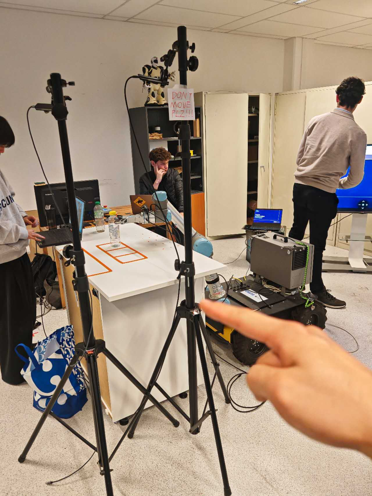
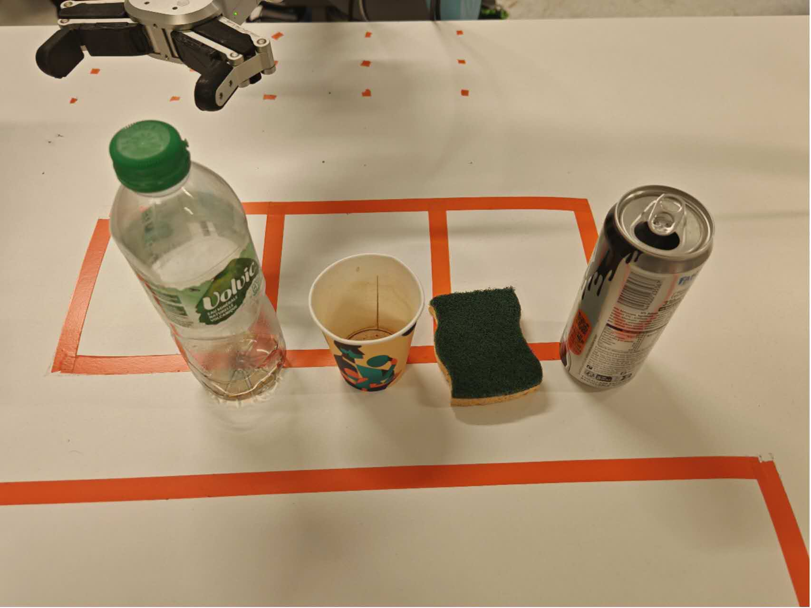

# UR5 Waste Sorting with ZED Mini and YOLO

A waste-sorting prototype combining an overhead ZED Mini stereo camera, a YOLO detector, a UR5 robot and an OnRobot RG6 gripper. The integrated application classifies an object, selects a taught pick-and-place route, plans motion and controls the robot through RTDE. It uses a custom planner, not MoveIt.

## Lab setup: do not move the fixed camera



**Do not move the fixed camera or its stand indicated by the pointing finger.** The workspace zones are tied to its current position. If the camera or stand moves, stop using the saved zones and recalibrate/revalidate the setup before operation. The robot-mounted camera is not the camera used for these tests.



Use the four objects shown above: **plastic bottle, paper cup, sponge and aluminium can**. The bottle, cup and can are routed to `LEFT_CELL` (recyclable); the sponge goes to `RIGHT_CELL` (residual). For a pick, place **one object at a time** at the corresponding taught pickup position. The configured can route uses the bottle's taught position and route. The photo shows the objects for identification, not validated simultaneous pickup positions.

## Repository layout

- [`integrated_robot/`](integrated_robot/README.md): integrated vision, state machine, motion planning, RTDE interface, taught routes and tests. This is the main application.
- `vision_workspace/`: original vision, teaching and diagnostic code, model weights and selected reference data. Some historical documents are in Chinese and describe earlier project stages.
- `images/`: the fixed-camera setup and the four demonstration objects.

The integrated source was developed by the team and incorporates [Hugo Durieux's repository](https://github.com/hugodurieux/ur5-waste-sorting), snapshot `11ae403`.

## Current status and operating limits

- The real-time ZED + YOLO + simulated-robot chain has been exercised with a plastic bottle. Real-robot cycles using recorded detections are reported in the integrated project's history.
- Real-time vision with the real robot is under supervised integration, not an unattended validated system. On 3 November 2026 an approach caused a `C153A5` protective stop; another attempt reached the grasp pose with the gripper to the right of the bottle. The cause and pickup alignment require onsite review before further physical execution.
- The physical tabletop is **not included** in the planner's collision model; the gripper collision geometry is assumed, not measured. A model check cannot guarantee collision-free motion. A qualified onsite operator must review the cell and path, use the pendant safety setup and emergency stop, and supervise every stage.
- Fixed placement uses the detected **class**, not a validated camera-to-robot grasp position. Visual classification does not prove the object is at its taught spot. Gripper output feedback does not verify a successful grasp. Do not bypass safety checks, clear recurring protective stops without investigation, or use unattended execution.

## Requirements

Python 3.10 or newer is required for the simulation. Real UR5 control additionally requires `ur_rtde`; live vision requires a compatible NVIDIA GPU, the ZED SDK and matching Python API (`pyzed`), plus YOLO dependencies. See [`integrated_robot/README.md`](integrated_robot/README.md). Compatibility varies by operating system and Python version; the lab tested a separately built `ur_rtde` 1.6.5 on Windows Python 3.13. Do not assume it installs from a prebuilt wheel in every environment.

From a terminal in `integrated_robot/`, install appropriate compatible dependencies for your environment:

```bash
python -m pip install -r requirements.txt
python -m pip install -r requirements-vision.txt
```

Install the ZED SDK and its Python API separately as described in the integrated README. Do not install packages into another project's environment without checking compatibility.

## 1. Run without hardware

From `integrated_robot/`:

```bash
python -m unittest discover -s tests
python run_sorting.py --replay fixtures/vision/plastic_bottle_stable.jsonl
```

This replays **recorded** detection results with a simulated robot. A successful run reports `SIMULATION`, `RESULT: COMPLETED` and `sorted 1 object(s)`; it does not move a robot or demonstrate live YOLO. Replace the fixture name with `sponge_stable.jsonl`, `paper_cup_stable.jsonl`, or `aluminum_can_stable.jsonl` for the corresponding object.

## 2. Live vision with a simulated robot

```bash
python run_sorting.py --zed
```

Check that the camera image and zone overlays still match the table, then press `V` in the camera window to confirm alignment for this session. Place one object in `PICK_ZONE`, at its taught pickup location for a later physical demonstration. The vision gate checks class, policy confidence (0.60), region and stability over five frames. This command uses a mock robot, not the real arm. Press `Q` to quit. Confirming the overlay is not camera-to-robot calibration.

## 3. Onsite real-robot integration

Only proceed after the onsite operator has investigated the stops and grasp misalignment, checked the actual table, tool, wiring, taught object positions and robot state, and confirmed the appropriate safety setup. The robot uses TCP offset zero in the supplied taught configuration. This setting is a coordinate convention, not a measured fingertip TCP. Do not edit safety or validation flags merely to force operation.

The read-only check is:

```bash
python tools/check_robot.py --ip 147.250.35.40
```

This reports the state and the simplified collision model; it does not check the unmodelled tabletop or prove the path safe. With a qualified operator and the existing supervised setup, the integrated README documents the `--zed --robot-ip ... --allow-unmeasured --confirm-before-picking` entry point. `--robot-ip` connects to a real controller and may command the robot; `--allow-unmeasured` explicitly permits incomplete geometry in supervised step mode. Confirm the actual object placement and each stage onsite, and stop immediately for unexpected behavior. Controller completion is not physical grasp verification.

## Data and privacy

The repository includes code, model weights, configurations, the 24 taught joint references and the two supplied setup photos. Local virtual environments, runtime logs and the original camera capture collections are excluded. Some source records contain historic lab IP addresses, paths and camera identifiers; they describe the lab environment and should be reviewed before reuse. The two photos are publicly visible in this public repository.
